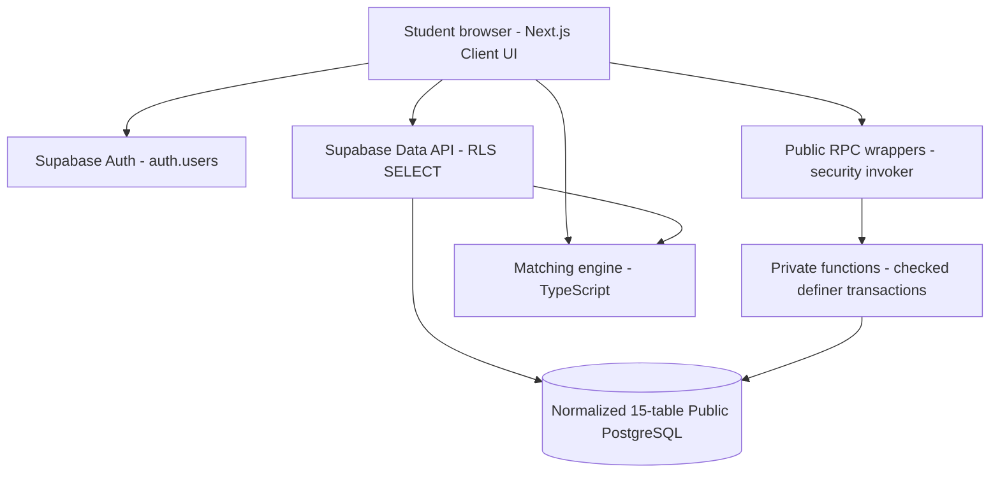

# ProjectLinkUMS — Full ERD Backend Flow

## Architecture



## Student joins project

```mermaid
sequenceDiagram
  actor B as Student B
  participant UI as Next.js
  participant DB as Supabase RPC + DB
  actor A as Project Owner A
  B->>UI: View project details & click Apply
  UI->>DB: apply_to_project(project_id,note)
  DB->>DB: Validate B is not owner, project open, no duplicate
  DB->>DB: Insert applications.pending & notification
  DB-->>UI: application UUID
  A->>UI: Review pending requests
  A->>UI: Accept
  UI->>DB: decide_application(application_id,'accepted')
  DB->>DB: Lock project; verify owner & capacity
  DB->>DB: Insert project_members + update application status (atomic)
  DB-->>UI: Done
  B->>UI: Refresh /requests
  UI-->>B: Status accepted
```

## Project owner invites student

```mermaid
sequenceDiagram
  actor A as Project owner
  participant UI as Next.js
  participant DB as Supabase
  actor C as Consenting candidate
  A->>UI: Choose own project on /matches
  UI->>DB: Read normalized skill, interest and availability rows
  DB-->>UI: RLS-visible data only
  UI->>UI: Filter mandatory criteria and score compatibility
  A->>UI: Invite C
  UI->>DB: invite_candidate(project_id,C,note)
  DB->>DB: Validate owner, open project, discovery consent
  DB->>DB: Insert invitation pending and notification
  C->>UI: Accept invitation
  UI->>DB: respond_invitation(invitation_id,'accepted')
  DB->>DB: Lock project; verify C & capacity
  DB->>DB: Atomically add project_members + accept invitation
```

## Matching rules summary

1. Eligibility: `discoverable && consent_at`, open project, no self-match, all mandatory skills present, minimum committed hours confirmed, required time slots overlap.
2. Scoring: skills 40%, shared project interests 25%, matching meeting time 20%, project-type goals 15%.
3. Compare **normalized UUIDs** (`skills.id`, `interests.id`); not freeform skills strings.
4. Unspecified optional dimensions score **50 neutral**, not 100.
5. This is a heuristic demo; beta feedback should guide future weighting.

## Beta accounts

- A creates project and approves B.
- B applies to A and sees Accepted.
- C opts into discovery, matches A's requirements, is invited by A and accepts.
- Use only test accounts created with permission; do not use imported survey identifiers.
